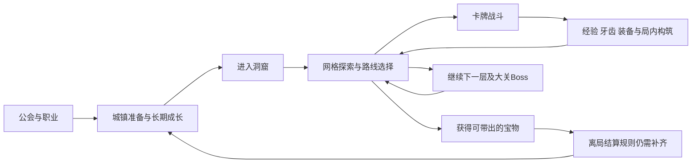

# 协作文档审阅与待明确事项

审阅日期：2026-10-27。结论基于两份协作者文档的完整 PDF、ZIP 导出的全部正文与原始图片。此报告负责还原逻辑、区分版本并提出缺口，不自行替协作者决定玩法。

已明确的全项目约束已写入根目录 [AGENTS.md](../AGENTS.md)。所有图表的逐项转录、页码覆盖及例子数值见 [协作图表逐项核对.md](协作图表逐项核对.md)。本报告中的“未明确”首先指**这两份协作材料的完整版规则未明确**；当前原型已有后续确认的部分单独列出，不要求重复确认。

## 1. 阅读范围与证据

| 材料 | 实际覆盖 |
|---|---|
| 设计元素 ZIP | 全部218行 Markdown、1张2160×1440参考游戏截图 |
| 策划文档 ZIP | 全部262行 Markdown、1张1178×849敌人意图图 |
| [设计元素 PDF](<References/协作文档_2026-10-27/设计元素 副本.pdf>) | 全部10页正文、11处图片／图表，包含旧天赋矩阵、项目天赋树、职业与物品清单、回合／伤害／逃跑图 |
| [策划文档 PDF](<References/协作文档_2026-10-27/魔塔肉鸽卡牌游戏-策划文档 副本 副本.pdf>) | 全部10页正文、7处图片／图表，包含6×6怪物轮换表、循环图、回合图、九职业图、敌人意图 |

上表图片数量按页面出现次数计，包含重复图。两份 PDF 原样归档，来源路径与SHA-256见 `References/协作文档_2026-10-27/来源清单.json`。以下简称“策划”和“设计”，页码是PDF文件页序。

**导出差异是本次阅读中的关键发现。** ZIP里确实没有独立表格或图表链接，但PDF保留了大量内嵌图片。因而“ZIP没有表格”不能推广成“原文没有表格”。补读PDF后，以下事项已经有答案，不再作为完全空白的问题：

- 探索所得装备与卡牌不能带出：策划第2页已有明确文字。
- 九个职业的名称及所属公会：策划第9页、设计第1页已有关系图。
- 速度决定每回合先后手；玩家开回合抽牌、回复行动点：回合图已写。
- 新强怪加入时最弱怪保留一层：策划第5页表格已有过渡规则。
- 天赋“已解锁”与“已携带”不同：设计第3页三色图例已写。
- 物品解锁已有八个具体例子；数值计算已有组成图；逃跑已有分支图。问题在于规则是否闭合，而不是完全没写。

## 2. 可以还原出的总体逻辑

玩家选择公会及职业体系，在城镇获得出发准备和长期成长，进入随机洞窟。在格子地图上选择路线、控制风险、争取经验／牙齿／装备／消耗品／宝物。卡牌战斗消耗局内资源，同时提供继续探索所需的成长。宝物带回城镇后推动公会、天赋、物品和剧情解锁，再影响下一次冒险。

这是材料之间可以连起来的关系，不表示每条转移的条件已完整定义。尤其“回城”“暂停本局”“正式离局”“失败”在完整版材料中尚未分清；当前原型则已有独立定义。

| 部分 | 已写出的逻辑 | 与其他部分的关键连接 |
|---|---|---|
| 核心体验与参考 | 路径规划、随机构筑、携宝发展公会 | 需要保证玩家能预估风险、主动决定继续或撤离；参考游戏只说明方向 |
| 世界观 | 地底人击退恶魔→阶级分化→交易与同化→内乱灭国→千年后传送门吸引地表冒险者 | 支撑洞窟遗址、宝物诱惑、失忆与公会城镇；未定义最终剧情目标 |
| 公会与职业 | 三公会、九职业；公会关联技艺牌、职业／武器关联武器牌 | 决定卡池、装备许可与剧情，选择和切换生命周期未给 |
| 公会成长 | 声望达门槛后花金币材料升级，开放天赋／物品／剧情或购买权 | 宝物如何稳定变为金币材料、声望是否消耗仍缺完整版规则 |
| 天赋 | 小节点属性、大节点机制；解锁与携带分离 | 金币／任务负责部分解锁，天赋点负责什么尚未说明；保险容量出现但未定义 |
| 城镇与任务 | 会长、导师、考古学家、铁匠、商店、珠宝商、使者、预言师、镇民、门卫等有职责 | 服务与公会等级、任务刷新、带出资源相连；酒馆仍占位 |
| 关卡与生态 | 随机网格、拟定60层、每15层大关Boss、四关生态；有怪物轮换示例 | 预言师控制前两关；第三关选择及第四关变体未补齐 |
| 地图交互 | 主动点阻挡并提供选项，被动点经过触发；火把改变视野 | 必须和可达性、拆墙、战斗入口、旧楼层状态配合 |
| 背包与装备 | 格子背包、七装备槽；局内装备成长与城镇0级装备并存 | 关系到拾取取舍、卡组生成、消耗品转卡和离局损失 |
| 局内成长与构筑 | 敌人掉经验；升级涉及属性及“升级卡牌奖励”；法师编辑牌，事件给特殊牌 | 初始牌组、稳定获牌、删改牌、换武器与旧牌关系尚未完整定义 |
| 卡牌战斗 | 速度判先、抽牌／回复行动点、出牌、敌方行动；行动点与次数双限制 | 需要牌堆、状态、死亡中断、多敌和逃跑的完整时序 |
| 伤害与防御 | 玩家由装备、属性修正、卡牌倍率等组成；敌人以意图白值为基础 | 要连接弱点、buff、防御、护盾、暴击、闪避与显示数值 |
| 难度与场景 | 可自由组合难度词条；关卡由网格、地块装饰、背景组成 | 未给词条组合约束和收益；场景描述是分层意图，尚不是表现规格 |
| 系统拆分 | 全局资源、局内等级、牙齿、卡组、实体、任务等职责有名称 | 需要明确同一状态由谁拥有，避免背包／卡组重复持有消耗品或多次结算 |

## 3. 优先澄清：影响完整规则闭合的事项

优先级仅代表对完整版规则推演的阻塞程度，不代表要求当前原型马上开发这些系统。P0是主循环或战斗无法无歧义推演；P1是系统接口、内容覆盖或体验边界；P2是设定和文档一致性。

### Q01｜P0｜完整版的一局如何结束，哪些资源如何结算？

**已知：** 探索所得装备、卡牌不能带出，宝物可带出；存在回城传送门，回城后可存宝物。（策划第2、5页；设计第5页）

**还缺：** 主动撤退、死亡、击败最终Boss、暂时回城、异常退出分别结束什么；牙齿、未用消耗品、城镇带入装备、经验和理智如何处理。“每次探险都将带出宝物”是愿景还是失败保底？应补一张“资源×退出方式”的结算表。当前原型已有存档回城和正式离局的区分，不应重新混在一起。

### Q02｜P0｜“保险容量”到底保护什么？

设计第3页天赋中央明确写“保险容量+1”，但没有保险系统定义。需写清保护物品类型、基础容量、主动选择还是自动选取、死亡／撤退何时生效、容量单位，以及与常规背包、仓库和带出容量的关系。不能把当前原型的主动10／失败5件直接解释成完整版保险制度。

### Q03｜P0｜按速度判先的回合图缺少敌方先手分支。

图首节点写“每回合根据速度值决定先后手”，但下一步始终是玩家回合。（策划第3、6页；设计第7页）应画出双方先手两条路径，并定义同速、多敌排序、每轮重判时点与中途变速。否则高低速度公会的核心差异无法可靠实现。行动轴旧设想已划掉，不能用它自动补全。

### Q04｜P0｜逃跑图没有脱战出口。

设计第10页的“是”分支直接进入敌人回合，再循环回战斗，没有成功、失败或返回地图。还绕过了“玩家回合结束”。需要明确是立即逃跑、先挨一轮再逃、概率判定或其他规则；补上结算、返回位置、敌人血量保留及失败代价。按现图只能实现跳过出牌，不能实现逃跑。

### Q05｜P0｜行动点和出牌次数缺少完整的补给与保留规则。

行动点回复时点已给，但起始值、回复量、上限、余量跨回合是否保留未定；出牌次数何时恢复未写。（策划第6—7页；设计第8页）现文字意味着0行动点牌也消耗一次出牌数；自动触发、复制牌、额外打出是否算次数仍需定义。不要把两个限制合成一种能量。

### Q06｜P0｜四个牌区的生命周期未写。

抽牌堆、弃牌堆、手牌、消耗堆只是名单。（策划第6页）需要起手、抽牌数、手牌上限、回合末弃牌、抽空洗牌、保留牌、战后恢复规则。消耗品牌是“本次冒险永久消耗”，其他牌进消耗堆是否只影响当前战斗需区分。当前原型已有自己的抽5／弃牌／洗牌规则，缺口限定于完整版。

### Q07｜P0｜消耗品从实物变成卡牌后如何计数？

已明确只能通过配置为牌在战斗内使用。（策划第7页）但未说明配置后是否仍占背包格、每个实物对应几张牌、何时可配置／撤回、弃掉或未抽到时是否损失、战斗外使用是否同步移除牌。需建立唯一库存和牌的对应关系，避免同一药剂被使用两次。

### Q08｜P0｜公会、职业、实际武器如何生成和改变卡组？

公会决定技艺牌方向、职业／武器影响武器牌已经明确，但“影响”可指可选卡池、初始牌组或直接附带卡牌。（策划第7—9页；设计第1、7页）需写出换武器后已有武器牌的处理、转职是否换牌、不同武器的使用许可。当前原型已规定同模板换剑只更新数值，不自动换牌，不能把该特例默认为全部职业的最终设计。

### Q09｜P0｜构筑的稳定来源和节奏不够明确。

普通敌人奖励列的是经验、牙齿、装备；法师可编辑牌，事件有事件牌；“升级卡牌奖励”可读作角色升级时奖励牌，也可读作卡牌强化奖励。（策划第5、7、9页）需明确初始牌组、升级选牌／强化、常规获牌、删除／替换、重复牌和牌组规模。参考《杀戮尖塔》不能替代这些规则。当前原型已限定升级三选一等阶段机制，无需重新确认。

### Q10｜P0｜伤害图已有组成，但缺可复算的完整版公式。

2026-10-28用户已补充明确：防御由武器或装备提供，武器中仅剑盾类提供防御；防御值直接作为伤害减免参与最终受伤计算。防御的来源及直接减伤含义已明确，不再列为待确认；当前原型继续逐段减防、再结算格挡。下文完整版公式的其余问题仍需分别处理。

设计第8—9页列出装备白值、三属性修正、修正等级、卡牌倍率、弱点、防御、buff；自身buff框未连线。需明确系数映射、加乘顺序、减防算法、取整、最低伤害，以及多段攻击逐段还是整次处理。实体正文的“法防”与分元素防御怎样对应，也需统一。当前原型v1已有明确物理伤害和格挡公式，应继续适用，而不是退回未知状态。

### Q11｜P0｜护盾、护甲、格挡与特殊伤害边界不清。

正式属性列“护盾”“物理防御”，旧废稿出现“护甲被破坏”，敌图画盾形图标；它们是否指不同资源未说明。神圣虽叫真实伤害，是否绕过护盾、闪避或通用减伤仍不可直接推定。盗贼依靠闪避，但每段／整次判定、暴击倍率、概率上限未写。（设计第2、7—10页）废稿的护甲破坏机制不能直接变成正式要求。

### Q12｜P0｜跨战斗状态及结束触发需要统一。

已有开战护盾、战后回血／回理智、下一战攻击翻倍／减伤等效果。（策划第5页；设计第10页）需定义生命、理智、行动点、护盾、状态、临时buff的保留范围；“下一战”是整场还是一次命中；逃跑是否触发战后恢复；死亡、反伤和持续伤害的结算优先顺序。否则可能出现重复恢复、buff提前消失或击败敌人后仍继续执行意图。

## 4. 系统接口与内容覆盖问题

| 编号／优先级 | 已有依据 | 需要补清的具体边界 |
|---|---|---|
| Q13／P1 经济 | 宝物带出；金币材料升级；捐红宝换声望；任务给金币声望（策划2、6；设计5） | 宝物出售／加工路径、材料来源、牙齿与金币是否能兑换、消费与产出节奏；名声／声望／外公会好感度是不是不同账本 |
| Q14／P1 天赋 | 解锁／携带三状态，金币／任务解锁，有天赋点（设计3） | 天赋点来源、节点点数成本、连线约束、洗点、是否公会或职业共享；壁垒／愈战愈勇的实际效果 |
| Q15／P1 物品解锁 | lv.1／2考古学家八项示例（设计4） | 等级属于公会还是NPC；解锁后是实物、掉落池、货架或锻造权；金币费是否只付一次；任务条件 |
| Q16／P1 角色与公会生命周期 | 选公会开始游戏，有九职业及外公会外交（策划8—9；设计1、5） | 选职业时机、解锁／切换、换公会、存档归属、外交收益；交好但暂不能进入不是必然矛盾 |
| Q17／P1 城镇0级装备 | 铁匠／珠宝商造0级物品，洞内可升级改造（设计5；策划5） | 0级是强化级、物品级还是门槛；一副盔甲覆盖哪些槽；带入与返回时的归属、强化保留 |
| Q18／P1 容量 | 背包一格一物、七装备槽、有限仓库（策划7；设计5） | 堆叠、已穿装备占格、任务材料、满包拾取／交换、仓库满的结算、扩容条件；现原型已有局部完整答案 |
| Q19／P1 怪物轮换 | 表格明确过渡一层（策划4—5） | 正文需同步；11层后、Boss层、跨大关的轮换；每种数量／权重／精英比例；旧楼层是否变化 |
| Q20／P1 大关变体 | 每关多变体，第四关只列古战场；预言师只选前两关（策划4；设计5—6） | 第四关是否特例／未写完；第三关怎么选；预言效果持续一局还是存档、能否改选、影响Boss／资源的范围 |
| Q21／P1 地图状态 | 网格随机、墙壁分类、主动点阻挡（策划5；设计6） | 出口可达性、开箱后通行、机关／密室条件、回上层、已清理状态、陷阱重复触发、交互点与敌人重叠规则 |
| Q22／P1 火把与信息 | 无火把3×3，有火把更大；无火把伏击在设想中（策划5、10） | 扩大多少、墙遮挡、是否保留探索记忆、按步数／时间／战斗消耗、来源；现行伏击规则不可沿用已删除旧图景 |
| Q23／P1 敌人意图 | 两个循环示例（策划8），敌人意图白值组成（设计9） | 首个动作、循环刷新、控制／跳过行动是否推进、是否预览后续动作、显示白值还是结算值、buff即时刷新；两人形不等于双敌同战 |
| Q24／P1 任务与NPC | 全部NPC对话选项、剧情／专属／日常／外公会委托（策划6、9；设计4—5） | 接取上限、刷新按现实日还是冒险次数、死亡后进度、交物扣除、仓库物品能否提交、随机NPC离开时如何交任务 |
| Q25／P1 难度 | 自由组合词条，入口火炬选难度（策划8；设计5） | 开放条件、互斥、选择时机、中途可否改、影响生成／数值的方式、奖励及成就关联 |
| Q26／P1 理智与洞察 | 理智进入属性／抗性／战后恢复，洞察仅在设想（设计9—10；策划10） | 理智扣除、归零后果、恢复、跨局留存、与失忆关系；洞察是否纳入当前设计，不应仅凭名字实现 |
| Q27／P1 系统职责 | 全局资源、局内等级、牙齿、卡组、实体各有职责（策划6—9） | 物品／牌唯一归属、奖励与经验发放顺序、同一事件只结算一次、存读档时哪个状态是依据；不是必须采用某种代码架构 |
| Q28／P2 故事与终局 | 恶魔被封印后仍开传送门吸魂，冒险者回来失忆（策划3—4） | 封印限制物理通行还是魔法；失忆是否对应成长重置；玩家终局目标和最终Boss。存在可行解释，不宜称硬性世界观矛盾 |
| Q29／P2 世界与表现 | 工业革命时期、火枪、魔法；地理背景空；网格／装饰／背景（策划4、9） | 武器技术与美术范围、地表王国和黑山关系、2D／2.5D表现及可交互图层。此处是规格不足，不由审阅者自行选风格 |
| Q30／P2 术语与版本 | 公会／工会、智慧／智力、雷／电、护甲／护盾／格挡、声望／名声混用 | 建术语映射与正式定义；“消耗品牌”“稿子”建议校正文案；给正式／示例／待定／废弃加状态标签，避免同名多义 |

## 5. 已有原型规格如何消解部分问题

这次写入全项目限制前，额外核对了项目内的阶段文档。用户已确认的阶段规格不应被本轮协作稿审阅撤销。

| 主题 | 当前原型已有答案 | 对审阅结论的影响 |
|---|---|---|
| 离局与存档 | 返回门“存档”保留本局且不结算，正式“结束游戏”或失败才带出 | Q01不是原型仍无退出规则 |
| 装备带出 | 属性v1第11节允许背包与已穿装备参与主动10／失败5件带出 | 与完整版装备不可带出有明确作用域差异；不能擅自删除原型功能 |
| 回合与牌堆 | 玩家先手、单敌、3能量、抽5、结束弃牌、抽空洗牌，速度暂缓 | Q03／05／06针对完整版图；当前不加入速度或次数限制 |
| 卡组与装备 | 初始5打击／4防御／1整备；升级三选一；同模板换剑不自动替换卡组 | Q08／09不是当前骑士原型无规则 |
| 属性与公式 | v1明确三属性武器修正、副属性每点1%、攻击与防御牌倍率、整数取整、逐段减防格挡 | Q10不能表述为项目没有公式；旧v0.1的10%和旧格挡提案不可恢复 |
| 槽位、容量与换装 | 当前三槽；穿戴不占背包；探索换装；满包交换及卸装条件已写 | Q18限定完整版，不能要求原型立即七槽 |
| 天赋与旧档 | 出发时捕获天赋，继续存档不重读新天赋；旧局按兼容模式 | 当前回城／继续游戏不能重新叠天赋或强改旧局规则 |
| 内容裁剪 | 当前骑士、五张图、十字五格视野；多职业、火把、理智等暂缓 | 完整版三公会、3×3视野和60层方向不自动扩大本轮开发范围 |
| 局外经济 | 当前有仓库出售／捐赠／扩容、公会升级等实现规格 | 能支撑原型闭环；其中价格、容量、初始金币仍是首轮试配，不能当协作稿定案 |

依据：[最小可玩模型范围_v0.1.md](最小可玩模型范围_v0.1.md)、[角色属性与装备系统完整原型设计_v1.0.md](角色属性与装备系统完整原型设计_v1.0.md)、[世界地图初版说明.md](世界地图初版说明.md)。本节只核对文档适用关系；后续源码与Unity MCP核查结果、修正清单及验证限制另见[原型对照与修正清单](原型对照与修正清单.md)。

## 6. 对协作者文档的建议补写顺序

1. **先补一局结算表。** 按资源列出存档回城、主动撤退、死亡、通关后的结果，并解释保险容量。它决定宝物、装备、仓库和成长的边界。
2. **补完整战斗时序。** 给一场玩家先手、一场敌方先手、一次逃跑的逐步例子；明确双资源刷新、牌堆、状态和战斗结束入口。
3. **补一条实物到卡组的实例。** 从获得武器／药剂、配置、换装、抽到、弃掉、使用、战后到离局，逐步追踪同一物品和同一张牌。
4. **补天赋与解锁状态表。** 将可购买、已解锁、已携带、任务达成、点数花费及公会等级分开，说明解锁物品到底进入哪里。
5. **统一图文和版本。** 将怪物过渡层写回正文，标出第四关变体覆盖状态，分开废稿矩阵、新天赋树、参考截图和试配价格，再补完整伤害公式与特殊类型。

这些是后续完善完整版设计的建议，不是要求重新批准已有原型规则。当前材料已足以说明作品方向、模块分工和若干关键边界；仍需补的是跨系统交接、状态生命周期和流程分支，尤其不能把图中示例直接当成最终全量配置。
