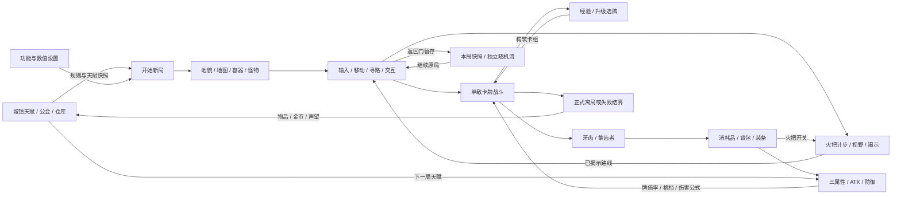

# 魔洞游戏现有功能思维导图

核查日期：2026-11-03。当前工作区源码与最新阶段文档；默认设置的新局行为。标注为规则逻辑的功能由C#实现，Unity API负责生命周期、输入、显示、资源与序列化。

[打开交互导图](现有功能思维导图.html) · [查看高清图片](现有功能思维导图.png) · [查看矢量图](现有功能思维导图.svg) · [可导入FreeMind/XMind的源文件](现有功能思维导图.mm)

交互版支持滚轮缩放、拖动画布、搜索、点击节点查看实现和Unity技术、系统关系图。HTML不需要联网或安装依赖。`.mm`为FreeMind格式，使用支持该格式导入的软件继续编辑。

## 主循环和系统联系

## 功能、实现与Unity标注

这里将Unity支撑和自定义规则分开标注：BFS、随机流、镇守入口验证、视线算法、伤害公式、经济规则属于项目C#实现。Unity提供输入、显示、生命周期、资源配置、序列化与编辑器能力。

### 01 流程与状态

串联城镇、探索、战斗与结算。

#### 游戏状态与面板

- 功能：主流程状态 + 叠加面板。
- 实现：GameScreen 控制主页、探索、战斗、奖励、结算与结果；GamePanel 控制背包、暂停、商店等面板。由 PrototypeGame 的 partial 文件共享状态。
- Unity功能 / API：MonoBehaviour；Update 每帧推进；OnGUI 绘制界面；C# enum 管理状态。
- 源码：[PrototypeGame.cs:11](../../Assets/MagicCavePrototype/Runtime/PrototypeGame.cs#L11) — `public enum GameScreen`

#### 开始新局与继续

- 功能：种子、地貌选择、规则快照。
- 实现：新局先生成地图，再复制设置、应用天赋、校验，成功后才替换旧存档；继续时复制已有本局快照，不重新生成地图。
- Unity功能 / API：Debug.Log 输出种子；Resources 间接加载属性配置；JsonUtility 支撑深拷贝。
- 源码：[PrototypeGame.cs:340](../../Assets/MagicCavePrototype/Runtime/PrototypeGame.cs#L340) — `public void StartNewRun(int seed, MapGenerationMode mode)`

#### 探索与战斗切换

- 功能：主动交互 → 单敌战斗 → 返回。
- 实现：相邻敌人交互调用 BeginBattle；ProcessBattle 处理胜败，胜利进入选牌或探索，失败进入正式结算。战斗保留本局生命与地图状态。
- Unity功能 / API：MonoBehaviour.Update；Time.deltaTime 驱动敌方行动等待；C# Battle 保存战斗状态。
- 源码：[PrototypeGame.cs:369](../../Assets/MagicCavePrototype/Runtime/PrototypeGame.cs#L369) — `public void BeginBattle`

#### 暂停、回城与离局

- 功能：手动存档与正式结算分流。
- 实现：面板和流程条件阻止移动或战斗推进；返回门可存档回城或正式离局。暂停退出按未保存提示处理，不自动发放带出奖励。
- Unity功能 / API：Input System 的 Escape；Application.Quit；暂停靠状态门控，未通过 Time.timeScale 实现。
- 源码：[PrototypeGame.cs:365](../../Assets/MagicCavePrototype/Runtime/PrototypeGame.cs#L365) — `void SaveAndLeave`

### 02 城镇与局外成长

为下一局提供职业、天赋和资源。

#### 世界地图与战士公会

- 功能：城镇 / 公会两套格子布局。
- 实现：TownPage、InGuild 管理公会入口、会长、导师、仓库和出发入口；城镇采用自己的格子布局与路径，复用方向输入及轮盘。
- Unity功能 / API：Input System；GUI.DrawTexture / GUI.Label 绘制城镇；Vector2.MoveTowards 平滑走格。
- 源码：[PrototypeTown.cs:220](../../Assets/MagicCavePrototype/Runtime/PrototypeTown.cs#L220) — `void DrawTownMap`

#### 三属性天赋星图

- 功能：前置条件、点亮、回撤返点。
- 实现：力量、敏捷、智慧三区；满足职业、公会、声望、前置和点数条件后点亮即激活。回撤须先处理依赖节点；初始3点、每级1点为试配，正式点数产出未接入。
- Unity功能 / API：GUI / Rect / Color 绘制节点；Texture2D 支撑星图；C# TownRules 校验；存储层立即保存。
- 源码：[TownProgression.cs:49](../../Assets/MagicCavePrototype/Runtime/TownProgression.cs#L49) — `public static string TalentLock`

#### 公会升级与成长快照

- 功能：金币 / 声望 → 条件与新局增益。
- 实现：会长提供公会升级；出发时 TownRules.Apply 写入属性与开场能量、格挡、战后回血等效果。城镇后来点亮或回撤，不改写已出发局。
- Unity功能 / API：IMGUI 展示条件；JsonUtility 复制本局状态；天赋规则为 C# 逻辑。
- 源码：[TownProgression.cs:71](../../Assets/MagicCavePrototype/Runtime/TownProgression.cs#L71) — `public static void Apply`

#### 局外仓库与资源处理

- 功能：存储、出售、捐赠、扩容。
- 实现：物品数量和装备实例分别保存；部分旧物品可出售，古代遗物可捐赠换声望，金币可扩容。新增装备和精华当前仅存储，未开放下局携入。
- Unity功能 / API：IMGUI 分页界面；JsonUtility 保存；容量和交易是 C# 规则。
- 源码：[PrototypeTown.cs:418](../../Assets/MagicCavePrototype/Runtime/PrototypeTown.cs#L418) — `void DrawTownWarehouse`

### 03 地图生成与布局

为探索提供地形、对象和路线风险。

#### 两种地貌与五层流程

- 功能：房间走廊 / 自然挖掘二选一。
- 实现：整局前4张探索图采用所选方式：房间25×25，自然挖掘31×31；第5张为固定首领图。生成验收失败重试；旧5层或8层存档保留原快照。
- Unity功能 / API：Vector2Int 表示格子；Mathf 辅助计算；房间、挖掘及连通验收由 C# 完成。
- 源码：[MapGenerator.cs:69](../../Assets/MagicCavePrototype/Runtime/MapGenerator.cs#L69) — `static MapData Generate`

#### 种子与独立随机流

- 功能：地图 / 洗牌 / 选牌 / 开箱分流。
- 实现：RandomStream 自行维护状态，按 seed + salt 派生各流；开箱、战斗和选牌互不挤占同一序列。复现要求生成版本、规则和相关操作顺序一致。
- Unity功能 / API：[Serializable] 数据；Debug.Log；随机为自定义 C# RandomStream，不依赖 UnityEngine.Random。
- 源码：[PrototypeData.cs:17](../../Assets/MagicCavePrototype/Runtime/PrototypeData.cs#L17) — `public sealed class RandomStream`

#### 箱袋与镇守入口布局

- 功能：永久障碍下验证可达性。
- 实现：默认10容器：2装备、5财宝、3消耗品；8受镇守、2无镇守。守卫覆盖原有地面交互入口，数量按入口生成；容器取空仍占格。可破墙绕行，开箱不检查守卫存活。
- Unity功能 / API：Vector2Int；Queue / HashSet 的 C# BFS；BoxCollider2D 在显示层提供实体组件。
- 源码：[MapGenerator.cs:534](../../Assets/MagicCavePrototype/Runtime/MapGenerator.cs#L534) — `public static bool ValidateCombatApproaches`

#### 楼梯、商人与安全出生

- 功能：路径连通、间距与避怪约束。
- 实现：验收永久容器和商人障碍下的地面、楼梯及交互位连通。返回门在第3层和首领胜利后提供；新局怪物等级按楼层。商人位置须八向避怪。
- Unity功能 / API：Vector2Int；自定义 C# 路径验收；SpriteRenderer 显示楼梯与对象。
- 源码：[MapGenerator.cs:501](../../Assets/MagicCavePrototype/Runtime/MapGenerator.cs#L501) — `public static bool ValidateContainerRoutes`

### 04 移动、导航与交互

把键鼠输入转成合法走格和操作。

#### 键盘走格与平滑表现

- 功能：先按仍按住的方向优先。
- 实现：输入事件保留按键先后；逻辑位置和存档在格心，显示位置在相邻格心间匀速插值，跨格继承剩余移动距离。洞窟3格/秒、城镇4格/秒为当前试配。
- Unity功能 / API：InputSystem.onEvent、Keyboard、InputEventPtr；Time.deltaTime；Vector2.MoveTowards。
- 源码：[PrototypeGame.cs:46](../../Assets/MagicCavePrototype/Runtime/PrototypeGame.cs#L46) — `void TrackMovementKeys`

#### 点击寻路与相邻交互

- 功能：只走已揭示通路；键盘可接管。
- 实现：BFS 避开墙、存活敌人、箱袋和商人；点对象先接近四向交互位再执行。不可达给提示，不自动破墙；合法通行由 MapData.CanTraverse 判定。
- Unity功能 / API：Camera.ScreenToWorldPoint 换算格子；Mouse.current；Vector2Int；寻路为 C# BFS。
- 源码：[MapGenerator.cs:670](../../Assets/MagicCavePrototype/Runtime/MapGenerator.cs#L670) — `public static List<Vector2Int> Path`

#### 方向轮盘与大小地图

- 功能：常驻 / 长按轮盘；点地图寻路。
- 实现：右下轮盘直接拖动；地图长按0.25秒临时呼出。大小地图仅接受已揭示、可通行且可达终点；放大地图阻止底层输入，点击可达地块后收起。
- Unity功能 / API：Mouse / Keyboard；Time.unscaledTime；GUI.DrawTexture、Rect；自绘地图与轮盘。
- 源码：[PrototypeNavigation.cs:37](../../Assets/MagicCavePrototype/Runtime/PrototypeNavigation.cs#L37) — `void ReadNavigationPointer`

#### 交互、碰撞与破墙

- 功能：E / 鼠标操作；破墙重建。
- 实现：TargetKind 区分敌人、容器、门、墙和商人。内部墙可一次破坏，边界墙不可破；修改 Tile 后重建墙线和视野。输入由面板和 UI 区域分流，避免点击穿透。
- Unity功能 / API：Input System；Camera；BoxCollider2D / PrototypeTarget 组件；通行主判定为 C# 网格检查。
- 源码：[PrototypeGame.cs:300](../../Assets/MagicCavePrototype/Runtime/PrototypeGame.cs#L300) — `void Interact(Target target)`

### 05 视野、火把与情报

决定可发现内容与路线信息。

#### 常规与火把视野

- 功能：3×3 / 5×5去四顶角。
- 实现：常规最多9格，火把最多21格；Supercover 射线处理墙体遮挡，斜向不能穿墙角；首个遮挡格可见，后方不揭示。首领地图全可见。
- Unity功能 / API：Vector2Int / Mathf 辅助；视线算法为 C#，未使用 Unity 2D Light 灯光。
- 源码：[MapGenerator.cs:616](../../Assets/MagicCavePrototype/Runtime/MapGenerator.cs#L616) — `public static bool HasLineOfSight`

#### 永久揭示与迷雾显示

- 功能：发现后保留；不等于当前视线。
- 实现：MapData.revealed 记录发现；移动、破墙、读档及切图刷新。已发现敌人、容器和门持续显示，小地图读取同一揭示记录。
- Unity功能 / API：SpriteRenderer 绘制遮罩；GameObject.SetActive / Renderer.enabled 控制显隐。
- 源码：[PrototypeWorld.cs:181](../../Assets/MagicCavePrototype/Runtime/PrototypeWorld.cs#L181) — `partial void RefreshVisibility`

#### 同一根火把可切换开关

- 功能：点燃消耗1根；保留剩余耐久。
- 实现：首次点燃取得20步耐久；手动熄灭保留耐久，再点燃同一根不重复消耗库存；耗尽后才需下一根。开关与剩余耐久随本局保存。
- Unity功能 / API：GUI / Input System 提供操作；TorchLight 是 C# 状态，未使用计时协程或实时灯光。
- 源码：[RunSystems.cs:8](../../Assets/MagicCavePrototype/Runtime/RunSystems.cs#L8) — `public static class TorchLight`

#### 照明与移动计步联动

- 功能：仅燃烧时的成功走格扣步。
- 实现：MoveGrid 成功后调用 TorchLight.Step，再刷新揭示和显示；碰墙、等待、战斗、交互、破墙不扣步，熄灭期间不扣步。
- Unity功能 / API：MonoBehaviour.Update 驱动移动；Vector2Int；计步依赖走格事件，非 Time 秒数。
- 源码：[PrototypeGame.cs:224](../../Assets/MagicCavePrototype/Runtime/PrototypeGame.cs#L224) — `bool MoveGrid`

### 06 物品、背包与装备

让探索产出成为可用资源。

#### 三类容器与首次开箱

- 功能：首次有效开启抽取；之后不重抽。
- 实现：装备箱、财宝箱、消耗品袋使用规则快照和 containerRandom；满包仍确定内容，支持部分拾取。新局空箱保持不透明开启外观、碰撞，取消交互。
- Unity功能 / API：[Serializable]；Sprite / SpriteRenderer 选择开闭图；随机和拾取为 C# 规则。
- 源码：[ContainerLoot.cs:74](../../Assets/MagicCavePrototype/Runtime/ContainerLoot.cs#L74) — `public static bool Open`

#### 20格背包与拖拽整理

- 功能：装备1件/格；同类材料最多20。
- 实现：Inventory 管理拾取、堆叠、整格交换和明确丢弃；ItemUnit 保存独立ID及获取顺序，为穿戴、带出和失败排序提供唯一身份。
- Unity功能 / API：OnGUI / GUI.DrawTexture 绘制格子；Mouse.current 处理拖拽；Rect 命中检测。
- 源码：[PrototypeItemGrid.cs:133](../../Assets/MagicCavePrototype/Runtime/PrototypeItemGrid.cs#L133) — `void ReadItemDrag`

#### 八个独立装备槽

- 功能：整件剑盾 + 四护甲 + 三戒指。
- 实现：拖入匹配部位可换装；旧装备退回来源格；卸装检查容量。剑盾只有一个实例，三个戒指分别记录实际槽位；旧木盾仅保留兼容入口。
- Unity功能 / API：IMGUI 格子与鼠标拖拽；ScriptableObject 属性配置；装备许可/交换为 C#。
- 源码：[RunSystems.cs:148](../../Assets/MagicCavePrototype/Runtime/RunSystems.cs#L148) — `public static string Equip`

#### 消耗品与三格快捷栏

- 功能：绑定背包类别；不复制库存。
- 实现：探索点击或1/2/3使用，背包页可点击；拾取/购买时有空位自动绑定，支持拖入替换和右键解绑。药剂回血、精华本局加属性、强攻药剂按战斗次数持续；当前无战斗消耗品牌。
- Unity功能 / API：Input System 数字键与鼠标；IMGUI 绘制；RunData.quickSlots / TorchLight 保存绑定与火把状态。
- 源码：[RunSystems.cs:29](../../Assets/MagicCavePrototype/Runtime/RunSystems.cs#L29) — `public static class QuickBar`

### 07 角色属性与数值

为卡面、预览和结算提供统一结果。

#### 角色模板与规则快照

- 功能：固定模板；成长属于本局。
- 实现：PrototypeAttributeSet 加载 CharacterRules，复制进 RunData；CharacterState 保存天赋、穿戴和增益。新局 secondary=None，取消副属性选择及最终伤害加成；旧局保留兼容。
- Unity功能 / API：ScriptableObject；[CreateAssetMenu]；Resources.Load；JsonUtility 深拷贝。
- 源码：[PrototypeAttributeSet.cs:9](../../Assets/MagicCavePrototype/Runtime/PrototypeAttributeSet.cs#L9) — `public static AttributeRules LoadRules`

#### 三属性、装备与实际ATK

- 功能：武器白值 + 三属性修正。
- 实现：Calculate 汇总模板、等级成长、天赋、装备和有效增益；武器上配置力量/敏捷/智慧修正。装备可提供生命、防御和属性；换装重算ATK并更新卡面，不替换卡组。
- Unity功能 / API：[Serializable] 配置/状态；纯 C# decimal 计算；未依赖 Unity 物理或动画计算伤害。
- 源码：[CharacterAttributes.cs:145](../../Assets/MagicCavePrototype/Runtime/CharacterAttributes.cs#L145) — `public static CharacterStats Calculate`

#### 等级与增益生命周期

- 功能：力量/生命成长；按场次结束增益。
- 实现：等级参与主属性与生命成长；精华写入本局永久 modifier，强攻药剂只在战斗中参与并按剩余战斗数衰减。战后回血、结束增益、经验升级按既定顺序执行。
- Unity功能 / API：[Serializable] 属性增益列表；C# 事件调用链；不使用 Animator 状态。
- 源码：[CharacterAttributes.cs:208](../../Assets/MagicCavePrototype/Runtime/CharacterAttributes.cs#L208) — `public static void FinishBattle`

#### 伤害、格挡与一致预览

- 功能：卡牌倍率；逐段减防再扣格挡。
- 实现：攻击取实际ATK×牌倍率，盾击取当前格挡；防御牌按模板读主属性或实际ATK。最终倍率后整数取整；每段先减防御、再扣格挡、再扣生命，预览复用同一计算。
- Unity功能 / API：Mathf 用于辅助显示；核心为 C# decimal + RoundDamage / CombatNumbers，防御不是百分比。
- 源码：[CharacterAttributes.cs:253](../../Assets/MagicCavePrototype/Runtime/CharacterAttributes.cs#L253) — `public static class CombatNumbers`

### 08 卡牌战斗与本局成长

把探索遭遇转成构筑和资源产出。

#### 单敌回合与资源

- 功能：玩家先手；3能量；每回合抽5。
- 实现：Battle 管理玩家/敌方回合；回合开始清自身格挡并补能抽牌；结束回合弃剩余牌，清战意；抽空洗弃牌。天赋可提供开场额外能量或初始格挡。
- Unity功能 / API：MonoBehaviour.Update 驱动敌方等待；Time.deltaTime；牌堆与回合为 C# 状态。
- 源码：[RunSystems.cs:258](../../Assets/MagicCavePrototype/Runtime/RunSystems.cs#L258) — `public sealed class Battle`

#### 十类卡牌与牌堆查看

- 功能：点击出牌；多手牌分页。
- 实现：起始牌为打击、防御、整备，另7类升级候选。Play 校验费用、移出手牌、按序结算、入弃牌堆；攻击对唯一敌人。界面可查看抽牌/弃牌组成。
- Unity功能 / API：OnGUI / GUI.Label / GUI.DrawTexture；Mouse.current；自绘按钮点击，而非 uGUI Button。
- 源码：[RunSystems.cs:294](../../Assets/MagicCavePrototype/Runtime/RunSystems.cs#L294) — `public bool Play`

#### 敌人意图、胜败与首领

- 功能：洞穴蝠 / 岩甲虫 / 岩洞守卫。
- 实现：三类敌人按各自循环展示意图；等级调整生命和攻击。胜利将该敌人标为 defeated、发经验和牙齿；首领胜利生成返回门和可配置遗物奖励，安全校正玩家站位。
- Unity功能 / API：SpriteRenderer 显示敌人；IMGUI 展示意图；C# BattleOutcome / defeated 状态。
- 源码：[RunSystems.cs:231](../../Assets/MagicCavePrototype/Runtime/RunSystems.cs#L231) — `public static void FinishVictory`

#### 经验升级与三选一构筑

- 功能：经验 → 升级 → 选牌/跳过。
- 实现：胜利普通10、首领30经验；升级曲线20+10×(L-1)，逐次给3种候选，可跳过。新卡写入本局deck；失败经验仅统计，直接结算。等级、卡组不继承新局。
- Unity功能 / API：IMGUI 候选卡界面；自定义 RandomStream 洗候选；C# Growth 管理升级。
- 源码：[RunSystems.cs:221](../../Assets/MagicCavePrototype/Runtime/RunSystems.cs#L221) — `public static List<CardKind> NextUpgrade`

### 09 牙齿与集齿者

战斗货币回流到探索消耗品。

#### 单局牙齿货币

- 功能：胜利发放；不占背包格。
- 实现：普通怪3、首领10颗为试配；defeated 防止重复发放。牙齿存 RunData，不入仓库、不兑换城镇金币，正式结束后不继承。
- Unity功能 / API：[Serializable] RunData；JsonUtility 保存；产出为 C# 规则。
- 源码：[ToothMerchant.cs:13](../../Assets/MagicCavePrototype/Runtime/ToothMerchant.cs#L13) — `public static int VictoryTeeth`

#### 随机商人分布

- 功能：每层至多1；连续5层至少2。
- 实现：PlanFloors 按种子安排普通楼层，再补足滑动窗口；首领层计入窗口但不生成商人。位置八向避怪，且不破坏永久障碍下的通路和交互位。
- Unity功能 / API：Vector2Int；自定义随机流和 C# 布局验收。
- 源码：[ToothMerchant.cs:14](../../Assets/MagicCavePrototype/Runtime/ToothMerchant.cs#L14) — `public static bool[] PlanFloors`

#### 消费、容量校验与交易

- 功能：药剂、火把、强攻药剂。
- 实现：购买前检查范围、开关、余额、背包与堆叠空间；成功后才扣牙齿并发物品，触发快捷栏自动绑定。失败不扣款、不推进物品ID。
- Unity功能 / API：IMGUI 商品界面；Input System 点击/E；Inventory.Pickup 复用物品逻辑。
- 源码：[ToothMerchant.cs:53](../../Assets/MagicCavePrototype/Runtime/ToothMerchant.cs#L53) — `public static string Buy`

#### 两套经济与资源方向

- 功能：牙齿用于本局；金币用于局外。
- 实现：探索商店回补本局消耗品；金币和声望由正式结算/局外处理获得，驱动公会与仓库。暂存回城只保存牙齿余额，不发城镇结算奖励。
- Unity功能 / API：JsonUtility 保存两类数据；经济换算为 C# TownRules，未自动兑换牙齿。
- 源码：[TownProgression.cs:90](../../Assets/MagicCavePrototype/Runtime/TownProgression.cs#L90) — `public static long SettlementGold`

### 10 调参与功能开关

控制随后新局的原型规则。

#### 主界面设置与草稿

- 功能：功能 / 卡牌 / 怪物 / 掉落。
- 实现：设置面板使用草稿；支持数值加减、文本输入、粘贴、确认、保存/取消及恢复默认。保存前校验；超出范围或空间不足会拒绝，不替换已有存档。
- Unity功能 / API：OnGUI / GUI；Keyboard.onTextInput；GUIUtility.systemCopyBuffer；Rect 点击。
- 源码：[PrototypeSettingsInterface.cs:63](../../Assets/MagicCavePrototype/Runtime/PrototypeSettingsInterface.cs#L63) — `void DrawSettings`

#### 十二类功能开关

- 功能：迷雾、消耗品、装备、镇守等。
- 实现：可切换火把、牙齿、商人、出发天赋、经验、选牌、破墙等。关闭掉落类别仍保留容器，可开空；关闭物品守卫是显式调试选项，默认布局规则继续有效。
- Unity功能 / API：[Serializable] PrototypeSettings；IMGUI；具体效果在 C# 系统入口判断。
- 源码：[PrototypeSettings.cs:8](../../Assets/MagicCavePrototype/Runtime/PrototypeSettings.cs#L8) — `public sealed class PrototypeSettings`

#### 卡牌、怪物与掉落调参

- 功能：费用/倍率/数量/权重/首领奖励。
- 实现：配置初始卡数量、费用、抽牌、倍率和战意；怪物生命、攻击、防御、格挡及自由怪数量；各池权重、数量范围、首领遗物概率。数值是原型试配。
- Unity功能 / API：JsonUtility 序列化配置；C# Validate 校验数组、范围和候选池。
- 源码：[PrototypeSettings.cs:29](../../Assets/MagicCavePrototype/Runtime/PrototypeSettings.cs#L29) — `public void Validate`

#### 仅随后新局生效

- 功能：复制设置与掉落池进本局。
- 实现：Apply 写入 settingsVersion=1 与规则副本，后续系统读取 PrototypeSettings.For(run)。继续旧局使用原快照，旧settingsVersion=0沿用原逻辑。
- Unity功能 / API：JsonUtility 深拷贝；[Serializable]；Resources 属性配置与本局设置快照并存。
- 源码：[PrototypeSettings.cs:45](../../Assets/MagicCavePrototype/Runtime/PrototypeSettings.cs#L45) — `public void Apply`

### 11 存档、结算与旧局兼容

持久化全部状态并防止重复奖励。

#### 三类JSON与原子写入

- 功能：session / warehouse / settings。
- 实现：默认路径由 Application.persistentDataPath 派生。临时文件写入、Flush后替换；本局、仓库/城镇、设置分别保存。设置损坏暂用默认，保留原文件。
- Unity功能 / API：Application.persistentDataPath；JsonUtility.ToJson / FromJson；文件读写用 .NET System.IO。
- 源码：[PrototypeStore.cs:99](../../Assets/MagicCavePrototype/Runtime/PrototypeStore.cs#L99) — `static void AtomicWrite`

#### 返回门存档与继续

- 功能：保存快照和随机进度。
- 实现：session 保存地图、揭示、墙体、敌人/容器、位置、生命、经验、牌组、背包、装备/属性/天赋、牙齿、火把开关耐久、快捷栏及各随机流。继续不重Roll、不领奖励。
- Unity功能 / API：[Serializable] 数据模型；JsonUtility 深拷贝与序列化；不是 PlayerPrefs 存档。
- 源码：[PrototypeStore.cs:131](../../Assets/MagicCavePrototype/Runtime/PrototypeStore.cs#L131) — `public void SaveCheckpoint`

#### 正式带出与防重复入账

- 功能：主动最多10件；失败最多5件。
- 实现：背包与穿戴装备一起选；失败按品质与获取时间自动取。PendingSettlement 保留待处理流程；run.id / committedRuns 账本防重复发物品、金币和声望。仓库不足则暂停提交。
- Unity功能 / API：JsonUtility 保存事务状态；System.IO 原子替换；C# 账本与容量检查。
- 源码：[PrototypeStore.cs:174](../../Assets/MagicCavePrototype/Runtime/PrototypeStore.cs#L174) — `public List<ItemUnit> CommitSettlement`

#### 版本迁移与旧档保护

- 功能：保留地图/规则/装备实例快照。
- 实现：读取时验证并对已定义字段迁移生成备份；旧地图不补怪、不重排，新局新增池不追补旧局；旧副属性、旧槽位和原层数按各自兼容路径处理。
- Unity功能 / API：ISerializationCallbackReceiver；JsonUtility；C# version 字段与 System.IO 备份。
- 源码：[PrototypeData.cs:188](../../Assets/MagicCavePrototype/Runtime/PrototypeData.cs#L188) — `public sealed class SessionData`

### 12 Unity表现与开发支撑

把逻辑数据呈现为可操作的原型。

#### 像素对象与墙体拼接

- 功能：16 PPU；Y排序；迷雾遮罩。
- 实现：BuildWorld 从 MapData 创建 GameObject、SpriteRenderer、BoxCollider2D 和 TextMesh。PixelWallTiles 按邻接地形与已知轮廓选择/生成图块，破墙后重建显示。
- Unity功能 / API：GameObject / Transform / AddComponent；SpriteRenderer.sortingOrder；Texture2D.GetPixels / Sprite.Create。
- 源码：[PrototypeWorld.cs:99](../../Assets/MagicCavePrototype/Runtime/PrototypeWorld.cs#L99) — `partial void BuildWorld`

#### 正交跟随与像素对齐

- 功能：固定朝向；整数像素缩放。
- 实现：ConfigurePixelCamera 固定正交及屏幕比例；LateUpdate 内跟随显示位置，用 SmoothDamp 平滑相机并对齐像素；人物按方向换Sprite / flipX。
- Unity功能 / API：Camera.orthographic；Screen.height；LateUpdate；Vector3.SmoothDamp；SpriteRenderer.flipX。
- 源码：[PrototypeWorld.cs:33](../../Assets/MagicCavePrototype/Runtime/PrototypeWorld.cs#L33) — `public static void ConfigurePixelCamera`

#### 资源配置、场景与构建工具

- 功能：已有编辑器工具源码支撑。
- 实现：PrototypeArtSet / PrototypeAttributeSet 定义资源配置；Editor构建器设导入、创建场景和Windows包。图中仅记录这些现有能力，本次未执行导入、改场景或构建。
- Unity功能 / API：ScriptableObject / Resources；TextureImporter / AssetDatabase；EditorSceneManager / BuildPipeline。
- 源码：[PrototypeArtSet.cs:7](../../Assets/MagicCavePrototype/Runtime/PrototypeArtSet.cs#L7) — `public sealed class PrototypeArtSet`；[PrototypeSceneBuilder.cs:98](../../Assets/MagicCavePrototype/Editor/PrototypeSceneBuilder.cs#L98) — `[MenuItem(`；[PrototypeSceneBuilder.cs:151](../../Assets/MagicCavePrototype/Editor/PrototypeSceneBuilder.cs#L151) — `BuildPipeline.BuildPlayer`

#### 规则与交互验证支撑

- 功能：EditMode / PlayMode 测试源码。
- 实现：Tests/Editor 覆盖地图、属性、背包、天赋、设置、交易与存档；Tests/PlayMode 覆盖真实输入、拖拽、轮盘、迷雾和流程。此图依据源码与文档核查，本次未重跑Unity测试。
- Unity功能 / API：Unity Test Framework；NUnit [Test]；[UnityTest] / IEnumerator；Input System 测试输入。
- 源码：[PrototypeVerification.cs:18](../../Assets/MagicCavePrototype/Editor/PrototypeVerification.cs#L18) — `TestRunnerApi`；[PrototypePlayTests.cs:30](../../Assets/MagicCavePrototype/Tests/PlayMode/PrototypePlayTests.cs#L30) — `[UnityTest]`

## 跨系统关系表

| 来源系统 | 目标系统 | 作用 | 说明 |
|---|---|---|---|
| 城镇与局外成长 | 流程与状态 | 天赋出发快照 | 点亮的天赋在开始新局时写入角色与战斗开场效果，已出发局保持原快照。 |
| 调参与功能开关 | 流程与状态 | 新局规则快照 | 先生成和应用配置并验证，成功后才替换旧存档。 |
| 流程与状态 | 地图生成与布局 | 生成整局地图 | 种子与地貌模式决定4张探索图，第5张为固定首领图。 |
| 地图生成与布局 | 移动、导航与交互 | 地形和障碍约束 | 导航使用实际地形与敌人、商人、永久容器占格。 |
| 移动、导航与交互 | 视野、火把与情报 | 成功移动与破墙 | 成功走格扣燃烧耐久并揭示，破墙后重新判断视线。 |
| 视野、火把与情报 | 移动、导航与交互 | 揭示范围限制寻路 | 点击寻路只能通过已揭示地面，大小地图共用揭示状态。 |
| 地图生成与布局 | 物品、背包与装备 | 容器与入口风险 | 位置、容器类别和守卫入口由地图生成；开箱和拾取不校验守卫存活。 |
| 物品、背包与装备 | 角色属性与数值 | 换装与消耗增益 | 装备和精华改变属性或防御，强攻药剂按战斗数持续。 |
| 角色属性与数值 | 卡牌战斗与本局成长 | 统一卡牌数值 | 实际ATK/主属性与牌倍率决定伤害和格挡；预览与结算共用公式。 |
| 移动、导航与交互 | 卡牌战斗与本局成长 | 相邻敌人主动交互 | 到达相邻交互位后才切入单敌战斗。 |
| 卡牌战斗与本局成长 | 移动、导航与交互 | 胜利后恢复通行 | 敌人defeated后不再阻挡，返回原探索位置。 |
| 卡牌战斗与本局成长 | 牙齿与集齿者 | 胜利发放牙齿 | 普通3、首领10为当前试配；每个敌人只发一次。 |
| 牙齿与集齿者 | 物品、背包与装备 | 购买消耗品入包 | 先检查牙齿与容量，成功后入包并尝试填快捷栏空位。 |
| 物品、背包与装备 | 视野、火把与情报 | 火把库存与开关 | 快捷格操作同一根有耐久的火把，影响视野形状并保留状态。 |
| 卡牌战斗与本局成长 | 存档、结算与旧局兼容 | 失败或主动离局结算 | 战败直接进入失败结算；首领胜利后须再经返回门正式离局。 |
| 存档、结算与旧局兼容 | 城镇与局外成长 | 物品 / 金币 / 声望入账 | 正式结算入仓与发局外奖励，run.id账本避免重复。 |
| 城镇与局外成长 | 角色属性与数值 | 天赋影响下一局属性 | 三属性/生命写入本局，战斗机制节点提供开场或战后效果。 |
| 调参与功能开关 | 地图生成与布局 | 怪物与分布开关 | 默认生成后按设置移除相应守卫，或配置目标自由怪数量。 |
| 调参与功能开关 | 卡牌战斗与本局成长 | 卡牌与怪物参数 | 费用、倍率、抽牌、意图数值和奖励开关读本局快照。 |
| 调参与功能开关 | 物品、背包与装备 | 掉落池与物品开关 | 有效物品按池权重生成，停用池允许空箱。 |
| 存档、结算与旧局兼容 | 流程与状态 | 继续快照 / 恢复待结算 | 读取检查点继续本局，或继续未完成的结算。 |
| 存档、结算与旧局兼容 | 地图生成与布局 | 保存实际地图结果 | 地形、门、对象、揭示、版本及随机进度随快照保存。 |
| 存档、结算与旧局兼容 | 物品、背包与装备 | 保存物品实例与绑定 | 独立ID、穿戴槽、背包、容器状态及快捷格一起保存。 |
| 存档、结算与旧局兼容 | 视野、火把与情报 | 保存揭示与火把状态 | 恢复剩余耐久与开关；旧清零火把不追补。 |
| Unity表现与开发支撑 | 地图生成与布局 | 绘制数据地图 | 地图数据驱动精灵、碰撞组件、标签与墙体连接。 |
| Unity表现与开发支撑 | 流程与状态 | 统一界面与更新入口 | IMGUI绘制面板，Input System处理交互，Update推进各状态。 |

## 适用范围、未实现项与核查限制

- 本图是现有实现说明，不新增玩法规则；默认数值、权重、初始点数等保留原型试配性质。
- 采用最新规则：4探索图+第5首领、8装备槽、无副属性、点亮即激活、9/21格视野、火把可反复开关。旧5层/8层局保留原快照。
- 运行时地图由自建网格数据、GameObject和SpriteRenderer实现；通行、寻路、视线是自定义C#，未接入Tilemap、NavMesh或实时2D灯光。
- 界面为OnGUI/IMGUI绘制，点击与拖拽由Input System自管；未以Canvas/uGUI、UI Toolkit或EventSystem作为这套原型交互主体。
- BoxCollider2D确有使用；核心走格碰撞检查是MapData.CanTraverse/CanStand，不应描述为Rigidbody2D物理移动。
- 本次只读源码和文档并生成导图，没有操作Unity编辑器、改资源或运行Unity测试，也未核实当前资产配置与运行包是否更新。
- 已知源码边界：全满仓且无可出售/扩容手段时，失败结算仍可能无恢复出口；仓库同名装备属性展示仍取首件。详见原型对照与修正清单R01/R03。
- 当前未实现的完整版范围：多公会/多职业、速度与独立出牌次数、战斗消耗品牌、元素/神圣/黑暗全规则、任务/制造/物品解锁、理智与完整逃跑流程。

## 文档依据

- [最小可玩模型范围_v0.1.md](../最小可玩模型范围_v0.1.md)（采用适用范围内的最新修订；历史数值不自动视为当前规则）
- [背包装备与三属性星图_2026-11-02.md](../背包装备与三属性星图_2026-11-02.md)（采用适用范围内的最新修订；历史数值不自动视为当前规则）
- [鼠标轮盘与小地图试验_2026-11-03.md](../鼠标轮盘与小地图试验_2026-11-03.md)（采用适用范围内的最新修订；历史数值不自动视为当前规则）
- [三格消耗品快捷栏_2026-11-03.md](../三格消耗品快捷栏_2026-11-03.md)（采用适用范围内的最新修订；历史数值不自动视为当前规则）
- [主界面设置面板_2026-11-03.md](../主界面设置面板_2026-11-03.md)（采用适用范围内的最新修订；历史数值不自动视为当前规则）
- [箱袋随机掉落与美术接入.md](../箱袋随机掉落与美术接入.md)（采用适用范围内的最新修订；历史数值不自动视为当前规则）
- [牙齿与集齿者_2026-11-02.md](../牙齿与集齿者_2026-11-02.md)（采用适用范围内的最新修订；历史数值不自动视为当前规则）
- [角色属性与装备系统完整原型设计_v1.0.md](../角色属性与装备系统完整原型设计_v1.0.md)（采用适用范围内的最新修订；历史数值不自动视为当前规则）
- [世界地图初版说明.md](../世界地图初版说明.md)（采用适用范围内的最新修订；历史数值不自动视为当前规则）
- [原型对照与修正清单.md](../原型对照与修正清单.md)（采用适用范围内的最新修订；历史数值不自动视为当前规则）

## 更新方法

编辑 `build_mindmap.py` 中的系统、功能和关系数据，运行 `python build_mindmap.py` 重新生成HTML、SVG、JSON、Markdown和FreeMind源文件。PNG由浏览器渲染SVG导出。仅生成文档，不连接Unity或写入Unity资源。
